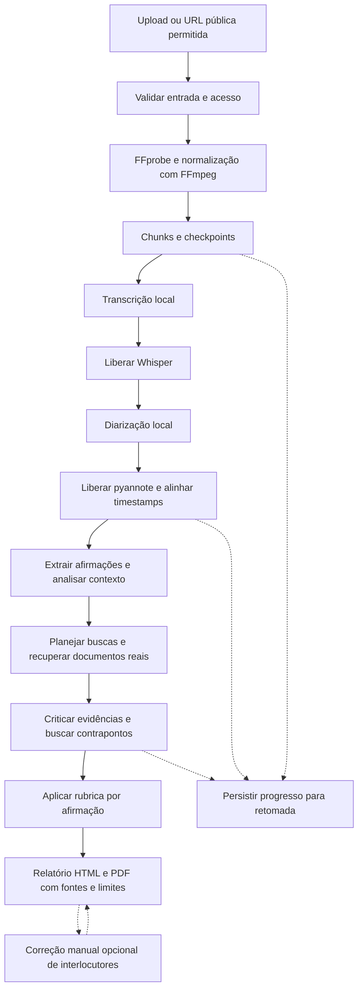
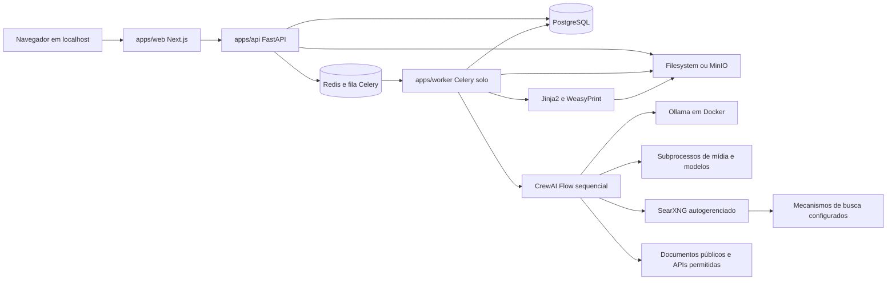
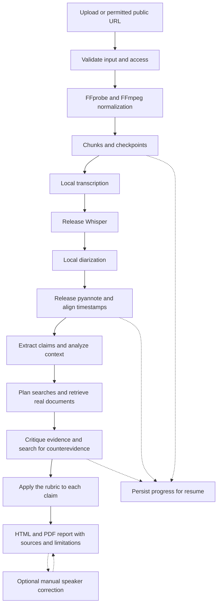
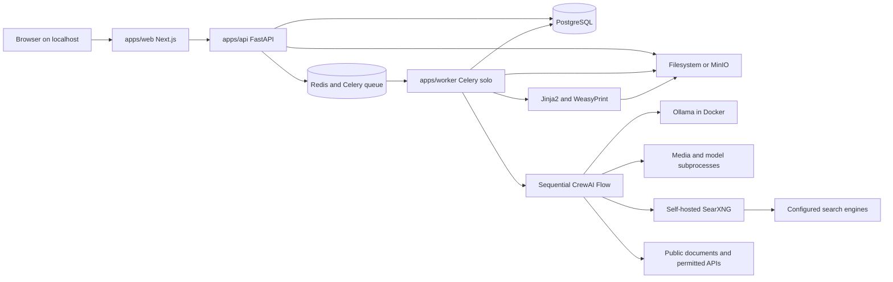

# Verifact AI

**Idioma / Language:** [Português (Brasil)](#pt-br) | [English (US)](#en-us)

An open-source, AI-powered fact-checking platform that analyzes political debates and speeches, transcribes media, researches factual claims, and generates transparent, evidence-based reports using local LLMs.

<a id="pt-br"></a>

## Português (Brasil)

**Idioma / Language:** [Português (Brasil)](#pt-br) | [English (US)](#en-us)

**Status: EM IMPLEMENTAÇÃO / AINDA NÃO VALIDADO DE PONTA A PONTA.** A infraestrutura Docker, a API, o worker e a interface têm código inicial. As seções abaixo preservam a especificação; existência de código não significa funcionalidade validada. Modelos e fluxo real completo ainda exigem verificação. Não há benchmarks de memória ou precisão.

### Estado operacional verificado

- **Verificado:** infraestrutura Docker com health checks, migrations PostgreSQL, API e Celery conectados, upload/hash/FFprobe/MinIO, transcrição real curta com MLX, retomada de checkpoint e pausa honesta por falta do token de diarização.
- **Verificado separadamente:** busca SearXNG e documento real do IBGE; build Next.js, testes de interface e navegação; renderização PDF com WeasyPrint e bibliotecas nativas configuradas.
- **Experimental:** sete agentes CrewAI, avaliação completa com Ollama, relatório da análise e comportamento em mídias longas. Código e testes sintéticos não equivalem a validação factual real.
- **Pendente:** validação completa com Community-1 (requer aceite e token), validação de downloads públicos nas três plataformas, extração de documentos PDF externos e benchmark representativo de qualidade/memória.

O Colima foi configurado com 4 GB por autorização do mantenedor; 2 GB encerravam o runner por falta de memória. Ollama usa CPU no Docker/macOS. Não se garante que toda carga caiba no Mac de 8 GB. Veja o [registro de validação](docs/VALIDATION.md) e o [guia de execução](docs/architecture/operations.md).

### Motivação, objetivos e público

Debates e discursos políticos combinam dados, opiniões, promessas e afirmações cujo contexto nem sempre cabe em um vídeo curto. Conferir essas informações exige localizar a declaração original, identificar período e população, consultar documentos e comparar metodologias.

O Verifact AI pretende tornar esse processo acessível e auditável na política e nas eleições brasileiras. O público inclui cidadãos, jornalistas, pesquisadores, educadores e organizações de acompanhamento do debate público. A proposta é organizar evidências para análise crítica, com inferência local e rastreabilidade das decisões.

Não se promete neutralidade perfeita nem certeza factual. O sistema não inferirá intenção política nem classificará políticos por honestidade. Avaliará afirmações individuais, com contexto, divergências e limitações. A verificação dos documentos originais continuará essencial.

### Escopo funcional — em implementação

- Interface moderna e acessível em português brasileiro; upload de MP3/MP4 por arrastar e soltar.
- Envio opcional de URLs públicas de YouTube, TikTok e Instagram, quando permitido e tecnicamente viável.
- Processamento em segundo plano, progresso por etapa, histórico local, erros compreensíveis, cancelamento e retomada.
- Transcrição com timestamps clicáveis, agrupamento de vozes e atribuição/correção manual de nomes.
- Análise individual de afirmações, com evidências favoráveis e contrárias, URLs e datas das fontes.
- Filtros por classificação, interlocutor e tema.
- Relatório HTML auditável e exportação em PDF.

### Fluxo planejado



Um CrewAI Flow determinístico governará as etapas. Software convencional executará mídia, busca, persistência e validação; agentes interpretarão conteúdo dentro de contratos estruturados. Uma resposta de LLM nunca será evidência factual independente.

### Arquitetura planejada



Três aplicações compartilharão o monorepo, sem microserviços adicionais por padrão. A API atenderá operações curtas; o worker fará o trabalho pesado. PostgreSQL será a fonte durável de estado. Redis servirá à fila e aos eventos transitórios; o status persistido permitirá recuperar acompanhamento após perda de eventos.

### Stack proposta

| Área | Tecnologias |
| --- | --- |
| Frontend | Next.js na versão estável compatível verificada na implementação, React, TypeScript, App Router |
| Interface e dados | Tailwind CSS, shadcn/ui, TanStack Query, Zod, cliente tipado gerado de OpenAPI |
| Testes web | Vitest, React Testing Library, Playwright |
| API e domínio | FastAPI, Python, Pydantic v2, SQLAlchemy 2, Alembic |
| Persistência e jobs | PostgreSQL, Redis, Celery solo com concorrência 1 |
| Objetos | MinIO; adaptador filesystem para desenvolvimento leve |
| Orquestração e inferência | CrewAI Flows, agentes sequenciais, Ollama local, saídas Pydantic |
| LLM | Qwen3 4B principal; Qwen3 1.7B como fallback configurável |
| Mídia | FFmpeg, FFprobe, MLX Whisper Small; Base como fallback; faster-whisper como alternativa portátil |
| Diarização e obtenção | pyannote.audio Community-1; adaptador yt-dlp opcional |
| Pesquisa | SearXNG autogerenciado com DuckDuckGo; outros mecanismos configuráveis, sem busca paga |
| Relatórios | Jinja2, HTML auditável, WeasyPrint para PDF |
| Ferramentas | pnpm workspace, uv, Docker Compose quando apropriado, GitHub Actions |
| Qualidade Python | pytest, Ruff, mypy |

As dependências estão fixadas em `uv.lock` e `pnpm-lock.yaml`, com Python 3.12, Next.js 16.4.3 e React 19.3.1 nesta implementação. Novas dependências continuam exigindo verificação na documentação oficial. Não há inferência paga ou hospedada. CrewAI inclui SDKs de provedores como dependências transitivas; o código usa somente Ollama local, conforme [ADR 002](docs/adr/002-local-inference-and-upstream-dependencies.md).

### Arquitetura multiagente

| Agente | Responsabilidade planejada |
| --- | --- |
| ClaimExtractorAgent | Extrair afirmações factuais atômicas e verificáveis, preservando texto exato, timestamps e trecho de origem |
| ContextAnalystAgent | Identificar datas, populações, métricas, geografia, contexto necessário e ambiguidades |
| ResearchPlannerAgent | Formular consultas diversas, orientadas a fontes primárias e à refutação |
| EvidenceResearcherAgent | Recuperar documentos reais por ferramentas controladas e registrar proveniência |
| EvidenceCriticAgent | Examinar metodologia, credibilidade, contexto ausente, conflitos e contraevidências |
| FactJudgeAgent | Aplicar rubrica documentada e justificar um veredito por afirmação |
| ReportWriterAgent | Redigir relatório compreensível em português brasileiro, com linguagem neutra, fontes e limitações |

Agentes executarão sequencialmente, compartilhando configuração de modelo quando possível. O Flow controlará transições, limites e recuperação. Saídas terão schemas Pydantic, referências verificadas e metadados de modelo e versão do prompt. Texto gerado não autorizará operações arbitrárias no sistema.

### Mídia, timestamps e interlocutores

FFprobe verificará o conteúdo real antes da normalização por FFmpeg. O áudio será processado inicialmente em chunks de 180 segundos com sobreposição de 5 segundos. Cada chunk terá identidade estável e offset para o original. A junção removerá duplicação nas bordas sem eliminar repetições legítimas da fala; isso exigirá testes de alinhamento.

MLX Whisper Small será o transcritor principal em Apple Silicon; Base será a opção mais leve. faster-whisper será a alternativa portátil, com consumo e qualidade a avaliar separadamente. pyannote.audio Community-1 fará diarização em etapa distinta. Seus rótulos representam clusters de voz, não identidades reais. Sobreposição de fala e fronteiras entre chunks podem produzir erros; será necessário reconciliar clusters entre chunks e representar atribuições incertas.

Nomes serão atribuídos ou corrigidos manualmente. O LLM não identificará candidatos por conta própria. Transcrições originais, correções e versões permanecerão rastreáveis, sem alterar silenciosamente citações de relatórios anteriores.

Não haverá limite fixo de duração da mídia. Limites configuráveis de disco, recursos, timeouts e concorrência poderão pausar ou recusar uma tarefa, com motivo explícito. Checkpoints permitirão retomar mídias longas sem repetir etapas válidas.

### Pesquisa, evidência e citações

A pesquisa buscará tanto confirmação quanto refutação no contexto de cada afirmação. SearXNG usará DuckDuckGo inicialmente; outros mecanismos serão opcionais. Snippets servirão à descoberta, não como substitutos dos documentos: conclusões exigirão material real recuperado e trechos pertinentes.

IBGE, TSE, Banco Central, Tesouro Nacional, Câmara, Senado e Portal da Transparência serão fontes prioritárias quando pertinentes. Fontes oficiais também exigem avaliação de método, atualização e escopo. APIs e endpoints serão confirmados em documentação real; não serão inventados nem terão restrições contornadas. Documentos primários serão distinguidos de comentários e reportagens. Cópias da mesma informação não serão contadas como confirmações independentes.

Cada fonte registrará URL, publisher, data de publicação quando disponível, data de recuperação, período aplicável e excertos relevantes. Datas ausentes serão marcadas como desconhecidas. Evidências ligarão esses trechos às afirmações, com localização no documento, relação de apoio ou oposição, método de obtenção e limitações. URL final, versões e hashes ajudarão a rastrear mudanças; cópias locais dependerão das permissões de uso.

Nunca serão fabricados fatos, links, fontes, excertos ou estatísticas. Ausência de resultados não significa falsidade, e falha de acesso não constitui contraevidência. Divergências metodológicas e incertezas serão preservadas. Fatos serão distinguidos de opiniões, previsões, promessas e alegações subjetivas. Instruções presentes em páginas serão conteúdo não confiável, nunca comandos aos agentes.

### Vereditos e limitações da classificação

| Valor | Critério planejado |
| --- | --- |
| TRUE | Evidência relevante sustenta a afirmação no contexto, período e escopo declarados |
| FALSE | Evidência relevante contradiz a afirmação; ausência de apoio por si só não basta |
| PARTIALLY_TRUE | Partes separáveis têm apoio e outras estão incorretas ou sem sustentação; explicar cada parte |
| MISLEADING_CONTEXT | Omissão ou comparação de contexto altera materialmente o sentido de dados ou trechos |
| INCONCLUSIVE | Evidência insuficiente, inacessível ou conflitante impede conclusão responsável |
| NOT_CHECKABLE | Opinião, promessa, previsão ou formulação não operacionalizável não permite verificação factual no momento |

Afirmações compostas serão divididas sempre que possível. A rubrica exigirá evidências identificadas, contrapontos, justificativa e limites, sem pontuações numéricas de confiança inventadas. Esses rótulos avaliam afirmações factuais individuais, não candidatos ou posições políticas. Não haverá ranking, nota, percentual de honestidade ou vencedor agregado.

### Estrutura planejada

```text
apps/
  web/                  Interface Next.js
  api/                  API, domínio, persistência e migrations
  worker/               Jobs, Flow, agentes, mídia, pesquisa e relatórios
packages/
  contracts/            OpenAPI e cliente TypeScript gerado
  config/               Configurações compartilhadas de ferramentas
infrastructure/         Compose e configuração operacional
tests/                  Integração, ponta a ponta e avaliações compartilhadas
docs/                   Guias, rubrica e decisões arquiteturais
```

Os diretórios já existem. O worker reutiliza contratos Python do domínio da API sem importar inicialização HTTP. Tipos públicos do frontend são gerados de OpenAPI em `packages/contracts`, usados por um cliente tipado, sem definições manuais paralelas.

Entidades previstas: `Analysis`, `MediaAsset`, `Speaker`, `TranscriptSegment`, `Claim`, `ResearchQuery`, `Source`, `Evidence`, `Verdict`, `AgentExecution`, `ProcessingCheckpoint` e `Report`. Relações ligarão análises à mídia, segmentos e interlocutores; afirmações aos segmentos; consultas às fontes; evidências e vereditos às afirmações; execuções, checkpoints e relatórios à versão da análise. O schema definitivo será decidido durante a implementação.

### API — implementação inicial

Os endpoints abaixo têm implementação inicial e schemas OpenAPI em `/docs`, com IDs opacos, paginação e erros estruturados. Criação retorna `202 Accepted`; a resposta identifica a análise, consultável pelo endpoint de status. Eventos usam SSE com consulta periódica de status como recuperação. A cobertura efetivamente executada está em [VALIDATION.md](docs/VALIDATION.md); downloads sociais são experimentais e exigem `make setup-social` e `SOCIAL_DOWNLOAD_ENABLED=true`.

| Método | Endpoint | Finalidade |
| --- | --- | --- |
| POST | `/api/v1/analyses/uploads` | Receber MP3/MP4 e enfileirar análise |
| POST | `/api/v1/analyses/from-url` | Validar URL permitida e enfileirar obtenção |
| GET | `/api/v1/analyses` | Listar histórico com paginação |
| GET | `/api/v1/analyses/{id}` | Consultar análise |
| GET | `/api/v1/analyses/{id}/status` | Consultar estado persistido e progresso |
| GET | `/api/v1/analyses/{id}/events` | Acompanhar eventos SSE |
| GET | `/api/v1/analyses/{id}/transcript` | Consultar transcrição e timestamps |
| GET | `/api/v1/analyses/{id}/speakers` | Listar clusters e nomes atribuídos |
| PATCH | `/api/v1/analyses/{id}/speakers/{speaker_id}` | Corrigir atribuição manual |
| GET | `/api/v1/analyses/{id}/claims` | Listar e filtrar afirmações |
| GET | `/api/v1/claims/{id}` | Consultar afirmação, evidências e veredito |
| GET | `/api/v1/analyses/{id}/report` | Obter relatório HTML |
| GET | `/api/v1/analyses/{id}/report.pdf` | Baixar PDF |
| POST | `/api/v1/analyses/{id}/cancel` | Solicitar cancelamento cooperativo |
| POST | `/api/v1/analyses/{id}/resume` | Retomar de checkpoint válido |
| GET | `/health` | Verificar saúde do processo da API |

Estados previstos: `QUEUED`, `RUNNING`, `PAUSED`, `CANCEL_REQUESTED`, `CANCELLED`, `FAILED` e `COMPLETED`. A etapa atual será um campo separado. Cancelar preservará checkpoints; retomar será validado e idempotente, sem segunda execução paralela. Alterações que invalidem resultados indicarão o que precisa ser reprocessado.

### Apple Silicon com 8 GB: orçamento inicial

| Recurso | Padrão inicial planejado |
| --- | --- |
| Inferência | Ollama em Docker no macOS; Qwen3 4B e fallback Qwen3 1.7B |
| Transcrição | MLX Whisper Small e fallback Base |
| Análises ativas | No máximo 1 em toda a instalação |
| Operações pesadas | No máximo 1, incluindo inferência e mídia pesada |
| Worker e agentes | Celery solo, concorrência 1; agentes sequenciais |
| Pesquisa web | Até 2 requisições simultâneas |
| Contexto LLM | 4096 tokens inicialmente, incluindo entrada e reserva de saída |
| Chunks | 180 segundos com sobreposição de 5 segundos |

Esses valores são hipóteses para benchmarking, não garantias de memória ou desempenho. Será necessário medir RAM, swap, disco, latência e qualidade no equipamento real. Reduzir modelo ou chunk não assegura que qualquer mídia caiba em memória.

Subprocessos por etapa liberarão recursos ao terminar. Antes de Whisper ou pyannote, o worker solicitará descarregamento do modelo Ollama e verificará a conclusão da etapa anterior; antes de retornar ao LLM, encerrará subprocessos pesados. Nunca manter intencionalmente Ollama, Whisper e pyannote carregados simultaneamente quando evitável. Serviço disponível não implica modelo residente. Um controle global de admissão será necessário: concorrência 1 não protege contra um segundo worker iniciado acidentalmente.

### Infraestrutura local e pré-requisitos planejados

PostgreSQL, Redis, SearXNG, MinIO e Ollama são gerenciados por Docker Compose. MinIO é o armazenamento padrão; filesystem permanece disponível como alternativa leve. API, worker e frontend executam no host. MLX permanece nativo por depender do Metal no macOS. Ollama no Docker usa CPU no macOS, sem aceleração Metal. Serviços e portas ficam em localhost, sem autenticação no MVP. A mudança foi solicitada pelo mantenedor e está registrada no [ADR 001](docs/adr/001-docker-local-services.md).

Uma instalação futura exigirá Git, Node.js/pnpm e Python/uv compatíveis, FFmpeg/FFprobe, Ollama e modelos selecionados. Docker com Compose atenderá aos serviços de infraestrutura. Dependências nativas do WeasyPrint e suporte de MLX/pyannote serão verificados para a plataforma. Pesos poderão exigir download inicial, aceite de termos e credenciais do distribuidor; isso não autoriza inferência hospedada.

Comandos e pré-requisitos atuais estão no [guia operacional](docs/architecture/operations.md). `make setup` prepara dependências e `.env`; `make infra-up` inicia serviços Docker; `make migrate` aplica migrations; `make setup-media` instala adaptadores; `make models-pull` baixa modelos; `make dev` inicia aplicações nativas. Inferência local não significa operação offline: pesquisa, obtenção de fontes e downloads iniciais exigem rede.

### Roadmap: cinco marcos

1. **Fundação e contratos:** domínio, OpenAPI inicial, ferramentas, migrations e infraestrutura mínima; histórico web conectado à API, com persistência verificada sem modelos.
2. **Mídia e recuperação:** upload validado, normalização, chunks, transcrição, diarização, alinhamento, correção manual, progresso e checkpoints; validar cancelamento e retomada no Mac de 8 GB.
3. **Verificação com evidências reais:** Flow e sete agentes sequenciais, pesquisa autogerenciada, proveniência, rubrica e avaliações com confirmação, refutação e inconclusão.
4. **Experiência e relatórios:** navegação temporal, filtros, histórico, evidências e HTML/PDF auditável; URLs públicas como adaptador opcional quando permitido.
5. **Robustez e preparação pública:** segurança, recuperação, avaliação de vieses e qualidade, medições de recursos, CI, documentação operacional e decisão de licença antes da distribuição pública.

Cada marco entregará um recorte funcional verificável. Critérios operacionais estão em [AGENTS.md](AGENTS.md).

### Privacidade, segurança e acesso lícito

Mídias, transcrições, metadados e relatórios serão armazenados localmente. Consultas de pesquisa sairão da máquina e poderão revelar trechos das afirmações; transmitir apenas contexto necessário. A obtenção de mídia também comunicará dados ao provedor. Definir retenção, limpeza de temporários e remoção local documentada antes de usar conteúdo sensível. Não prometer anonimato, criptografia ou conformidade legal automática.

Uploads precisarão de limites configuráveis, inspeção de formato real, nomes internos seguros e ferramentas sem interpolação de shell. Downloads deverão prevenir SSRF, bloquear destinos internos e metadados de nuvem, revalidar DNS/redirecionamentos e limitar bytes, tempo e protocolos. HTML/PDF deverá escapar conteúdo e impedir acesso arbitrário à rede ou a arquivos locais.

URLs sociais serão opcionais e best-effort. Não haverá bypass de DRM, login, paywall ou conteúdo privado. Respeitar termos, APIs, licenças, restrições e rate limits. Material público não é automaticamente redistribuível. Credenciais não entrarão no Git ou nos relatórios. Ausência de autenticação só será aceitável em localhost; exposição em rede exigirá decisão de segurança separada.

### Limitações da proposta

Modelos podem alucinar, reproduzir vieses e interpretar contexto incorretamente. Transcrição e diarização podem errar em ruído, sotaques e fala simultânea; atribuições de interlocutores podem permanecer incertas. Fontes podem estar incompletas, desatualizadas, indisponíveis ou divergir por método. Conteúdo removido e falhas de busca reduzem cobertura. Modelos pequenos e contexto limitado podem perder relações importantes em discursos longos.

Essas limitações aparecerão no relatório, com possibilidade de `INCONCLUSIVE`. A ferramenta auxiliará a verificação, sem substituir pesquisa especializada ou revisão humana. Não há garantias de precisão, desempenho ou compatibilidade medidas nesta fase.

### Contribuição e licença

**Contribuição: em preparação.** Guia, fluxo de revisão e instruções de desenvolvimento serão publicados após revisão da arquitetura. Sugestões devem preservar evidências verificáveis, execução local e limites explícitos.

**Licença: ainda não decidida.** A intenção é distribuir como open source; este documento não concede licença de código nem presume um arquivo `LICENSE`. Código, modelos e fontes exigirão verificações próprias de licença.

---

<a id="en-us"></a>

## English (US)

**Idioma / Language:** [Português (Brasil)](#pt-br) | [English (US)](#en-us)

**Status: IMPLEMENTATION IN PROGRESS / NOT YET VALIDATED END TO END.** Docker infrastructure, API, worker, and UI have initial code. Sections below preserve the specification; code existence does not imply verified functionality. Models and the full live pipeline still require validation. There are no memory or accuracy benchmarks.

### Verified operational status

- **Verified:** healthy Docker infrastructure, PostgreSQL migrations, connected API/Celery, upload/hash/FFprobe/MinIO, real short MLX transcription, checkpoint resume, and an honest pause when diarization credentials are missing.
- **Verified separately:** SearXNG search and a real IBGE document; Next.js build, UI/navigation tests; PDF rendering with configured native WeasyPrint libraries.
- **Experimental:** seven-agent CrewAI verification, complete Ollama assessment, analysis report generation, and long-media behavior. Code and synthetic tests are not real factual validation.
- **Pending:** complete Community-1 validation (terms acceptance/token required), validated public downloads across all three platforms, extraction of external PDF documents, and representative quality/memory benchmarks.

Colima was configured with 4 GB with maintainer approval; 2 GB killed the model runner due to memory pressure. Ollama uses CPU in Docker on macOS. The full workload is not guaranteed to fit an 8 GB Mac. See the [validation ledger](docs/VALIDATION.md) and [operations guide](docs/architecture/operations.md).

### Motivation, goals, and audience

Political debates and speeches combine data, opinions, promises, and assertions whose context does not always fit into a short video. Checking them requires locating the original statement, identifying the relevant period and population, consulting documents, and comparing methodologies.

Verifact AI aims to make this process accessible and auditable for Brazilian politics and elections. Intended audiences include citizens, journalists, researchers, educators, and organizations monitoring public debate. The goal is to organize evidence for critical examination through local inference and traceable decisions.

The system does not promise perfect neutrality or factual certainty. It will not infer political intent or rate politicians by honesty. It will assess individual assertions, including context, disagreements, and limitations. Checking the original documents will remain essential.

### Feature scope — implementation in progress

- Modern, accessible Brazilian Portuguese interface; drag-and-drop MP3/MP4 uploads.
- Optional public YouTube, TikTok, and Instagram URLs, where permitted and technically feasible.
- Background processing, stage progress, local history, understandable errors, cancellation, and resume.
- Transcripts with clickable timestamps, voice clustering, and manual speaker naming/correction.
- Individual claim analysis with supporting and opposing evidence, source URLs, and dates.
- Filters by classification, speaker, and topic.
- Auditable HTML reports and PDF export.

### Planned workflow



A deterministic CrewAI Flow will govern the stages. Conventional software will handle media, search, persistence, and validation; agents will interpret content within structured contracts. An LLM response will never count as independent factual evidence.

### Planned architecture



Three applications will share the monorepo, without additional microservices by default. The API will handle short operations; the worker will handle heavy processing. PostgreSQL will be the durable source of state. Redis will provide the queue and transient events; persisted status will allow progress tracking to recover after event loss.

### Proposed stack

| Area | Technologies |
| --- | --- |
| Frontend | Latest stable compatible Next.js verified during implementation, React, TypeScript, App Router |
| Interface and data | Tailwind CSS, shadcn/ui, TanStack Query, Zod, typed OpenAPI-generated client |
| Web testing | Vitest, React Testing Library, Playwright |
| API and domain | FastAPI, Python, Pydantic v2, SQLAlchemy 2, Alembic |
| Persistence and jobs | PostgreSQL, Redis, Celery solo with concurrency 1 |
| Objects | MinIO; filesystem adapter for lightweight development |
| Orchestration and inference | CrewAI Flows, sequential agents, local Ollama, Pydantic outputs |
| LLM | Qwen3 4B primary; configurable Qwen3 1.7B fallback |
| Media | FFmpeg, FFprobe, MLX Whisper Small; Base fallback; faster-whisper portable alternative |
| Diarization and retrieval | pyannote.audio Community-1; optional yt-dlp adapter |
| Research | Self-hosted SearXNG with DuckDuckGo; configurable additional engines, no paid search |
| Reports | Jinja2, auditable HTML, WeasyPrint for PDF |
| Tooling | pnpm workspace, uv, Docker Compose where appropriate, GitHub Actions |
| Python quality | pytest, Ruff, mypy |

Dependencies are locked in `uv.lock` and `pnpm-lock.yaml`, with Python 3.12, Next.js 16.4.3, and React 19.3.1 in this implementation. New dependencies still require official-documentation checks. No paid or hosted inference is used. CrewAI includes provider SDKs transitively; application inference uses only local Ollama, as recorded in [ADR 002](docs/adr/002-local-inference-and-upstream-dependencies.md).

### Multi-agent architecture

| Agent | Planned responsibility |
| --- | --- |
| ClaimExtractorAgent | Extract atomic, verifiable factual claims while preserving exact wording, timestamps, and the original passage |
| ContextAnalystAgent | Identify dates, populations, metrics, geography, necessary context, and ambiguities |
| ResearchPlannerAgent | Form diverse queries oriented toward primary sources and falsification |
| EvidenceResearcherAgent | Retrieve real documents through controlled tools and record provenance |
| EvidenceCriticAgent | Examine methodology, credibility, missing context, conflicts, and counterevidence |
| FactJudgeAgent | Apply a documented rubric and justify a verdict for each claim |
| ReportWriterAgent | Write understandable Brazilian Portuguese reports with neutral wording, sources, and limitations |

Agents will execute sequentially, sharing model configuration where possible. The Flow will control transitions, budgets, and recovery. Outputs will have Pydantic schemas, verified references, model metadata, and prompt versions. Generated text will not authorize arbitrary system operations.

### Media, timestamps, and speakers

FFprobe will inspect actual content before FFmpeg normalization. Audio will initially be processed in 180-second chunks with a 5-second overlap. Each chunk will have a stable identity and an offset to the original media. Merging will remove boundary duplication without deleting legitimate repeated speech; this requires alignment tests.

MLX Whisper Small will be the primary transcriber on Apple Silicon; Base will be the lighter option. faster-whisper will be the portable alternative, with resource usage and quality evaluated separately. pyannote.audio Community-1 will perform diarization in a distinct stage. Its labels represent voice clusters, not real-world identities. Overlapping speech and chunk boundaries can cause errors; clusters must be reconciled across chunks and uncertain assignments represented explicitly.

Names will be assigned or corrected manually. The LLM will not identify candidates on its own. Original transcripts, corrections, and versions will remain traceable without silently changing quotations in earlier reports.

There will be no fixed media-duration cap. Configurable disk, resource, timeout, and concurrency limits may pause or reject a task with an explicit reason. Checkpoints will allow long media to resume without repeating valid completed stages.

### Research, evidence, and citations

Research will seek both confirmation and falsification in each claim's context. SearXNG will initially use DuckDuckGo; other engines will be optional. Snippets will support discovery, not replace documents: conclusions will require actual retrieved material and relevant excerpts.

IBGE, TSE, Banco Central, Tesouro Nacional, Câmara, Senado, and Portal da Transparência will be priority sources where relevant. Official sources still require assessment of methodology, freshness, and scope. APIs and endpoints will be confirmed through real documentation, never invented or accessed by circumventing restrictions. Primary documents will be distinguished from commentary and reporting. Copies of the same information will not count as independent confirmation.

Each source will record its URL, publisher, publication date when available, retrieval date, applicable period, and relevant excerpts. Missing dates will be marked unknown. Evidence will link excerpts to claims, including document location, supporting or opposing relationship, retrieval method, and limitations. Final URLs, versions, and hashes will help track changes; local copies will depend on usage permissions.

Facts, links, sources, excerpts, and statistics must never be fabricated. Missing results do not mean falsehood, and access failures are not counterevidence. Methodological disagreements and uncertainty will be preserved. Facts will be distinguished from opinions, forecasts, promises, and subjective assertions. Instructions embedded in pages will be untrusted content, never agent commands.

### Verdicts and classification limits

| Value | Planned criterion |
| --- | --- |
| TRUE | Relevant evidence supports the assertion in its stated context, period, and scope |
| FALSE | Relevant evidence contradicts the assertion; lack of support alone is insufficient |
| PARTIALLY_TRUE | Separable parts are supported while others are incorrect or unsupported; explain each part |
| MISLEADING_CONTEXT | Omitted or compared context materially changes the meaning of data or excerpts |
| INCONCLUSIVE | Insufficient, inaccessible, or conflicting evidence prevents a responsible conclusion |
| NOT_CHECKABLE | An opinion, promise, forecast, or non-operationalizable statement cannot currently be factually verified |

Compound claims will be split where possible. The rubric will require identified evidence, counterpoints, reasoning, and limitations, without fabricated numerical confidence scores. These labels assess individual factual assertions, not candidates or political positions. There will be no aggregate honesty ranking, score, percentage, or winner.

### Planned repository structure

```text
apps/
  web/                  Next.js interface
  api/                  API, domain, persistence, and migrations
  worker/               Jobs, Flow, agents, media, research, and reports
packages/
  contracts/            OpenAPI and generated TypeScript client
  config/               Shared tooling configuration
infrastructure/         Compose and operational configuration
tests/                  Shared integration, end-to-end, and evaluation tests
docs/                   Guides, rubric, and architecture decisions
```

These directories now exist. The worker reuses API domain contracts in Python without importing HTTP startup. Public frontend types are generated from OpenAPI in `packages/contracts` and consumed by a typed client rather than maintained manually in parallel.

Planned entities: `Analysis`, `MediaAsset`, `Speaker`, `TranscriptSegment`, `Claim`, `ResearchQuery`, `Source`, `Evidence`, `Verdict`, `AgentExecution`, `ProcessingCheckpoint`, and `Report`. Relationships will connect analyses to media, segments, and speakers; claims to segments; queries to sources; evidence and verdicts to claims; and executions, checkpoints, and reports to analysis versions. The final schema will be determined during implementation.

### API — initial implementation

The endpoints below have initial implementations and OpenAPI schemas at `/docs`, with opaque IDs, pagination, and structured errors. Creation returns `202 Accepted` and an analysis identifier for the status endpoint. Events use SSE with polling recovery. Executed coverage is recorded in [VALIDATION.md](docs/VALIDATION.md); social downloads are experimental and require `make setup-social` and `SOCIAL_DOWNLOAD_ENABLED=true`.

| Method | Endpoint | Purpose |
| --- | --- | --- |
| POST | `/api/v1/analyses/uploads` | Receive MP3/MP4 and queue analysis |
| POST | `/api/v1/analyses/from-url` | Validate a permitted URL and queue retrieval |
| GET | `/api/v1/analyses` | List paginated history |
| GET | `/api/v1/analyses/{id}` | Retrieve analysis |
| GET | `/api/v1/analyses/{id}/status` | Retrieve persisted state and progress |
| GET | `/api/v1/analyses/{id}/events` | Track SSE events |
| GET | `/api/v1/analyses/{id}/transcript` | Retrieve transcript and timestamps |
| GET | `/api/v1/analyses/{id}/speakers` | List clusters and assigned names |
| PATCH | `/api/v1/analyses/{id}/speakers/{speaker_id}` | Correct manual assignment |
| GET | `/api/v1/analyses/{id}/claims` | List and filter claims |
| GET | `/api/v1/claims/{id}` | Retrieve claim, evidence, and verdict |
| GET | `/api/v1/analyses/{id}/report` | Retrieve HTML report |
| GET | `/api/v1/analyses/{id}/report.pdf` | Download PDF |
| POST | `/api/v1/analyses/{id}/cancel` | Request cooperative cancellation |
| POST | `/api/v1/analyses/{id}/resume` | Resume from a valid checkpoint |
| GET | `/health` | Check API process health |

Planned states: `QUEUED`, `RUNNING`, `PAUSED`, `CANCEL_REQUESTED`, `CANCELLED`, `FAILED`, and `COMPLETED`. The current stage will be a separate field. Cancellation will preserve checkpoints; resume will be validated and idempotent, without a second parallel execution. Changes invalidating results will identify what must be reprocessed.

### Apple Silicon with 8 GB: initial budget

| Resource | Planned initial default |
| --- | --- |
| Inference | Docker-managed Ollama on macOS; Qwen3 4B with Qwen3 1.7B fallback |
| Transcription | MLX Whisper Small with Base fallback |
| Active analyses | Maximum 1 installation-wide |
| Heavyweight operations | Maximum 1, including inference and heavy media processing |
| Worker and agents | Celery solo, concurrency 1; sequential agents |
| Web research | Up to 2 simultaneous requests |
| LLM context | Initially 4096 tokens including input and reserved output |
| Chunks | 180 seconds with a 5-second overlap |

These values are benchmarking hypotheses, not memory or performance guarantees. RAM, swap, disk, latency, and quality must be measured on actual hardware. Reducing model or chunk size does not guarantee that any media will fit in memory.

Stage-specific subprocesses will release resources upon completion. Before Whisper or pyannote runs, the worker will request Ollama model unloading and verify that the previous stage has finished; before returning to the LLM, it will terminate heavy subprocesses. Never intentionally keep Ollama, Whisper, and pyannote heavyweight models loaded simultaneously when avoidable. An available service does not imply a resident model. Global admission control will be necessary: concurrency 1 does not protect against an accidentally started second worker.

### Local infrastructure and planned prerequisites

PostgreSQL, Redis, SearXNG, MinIO, and Ollama are managed by Docker Compose. MinIO is the default storage backend; filesystem remains a lightweight alternative. API, worker, and frontend run on the host. MLX remains native because it requires macOS Metal. Ollama in Docker uses CPU on macOS, without Metal acceleration. Published ports are restricted to localhost, without authentication in the MVP. This maintainer-requested change is recorded in [ADR 001](docs/adr/001-docker-local-services.md).

A future installation will require Git, compatible Node.js/pnpm and Python/uv versions, FFmpeg/FFprobe, Ollama, and selected models. Docker with Compose will provide infrastructure services. Native WeasyPrint dependencies and MLX/pyannote platform support will be verified. Weights may require an initial download, acceptance of terms, and distributor credentials; this does not authorize hosted inference.

Current commands and prerequisites are in the [operations guide](docs/architecture/operations.md). `make setup` prepares dependencies and `.env`; `make infra-up` starts Docker services; `make migrate` applies migrations; `make setup-media` installs adapters; `make models-pull` downloads models; `make dev` starts native applications. Local inference does not imply offline operation: research, source retrieval, and initial downloads require network access.

### Roadmap: five milestones

1. **Foundation and contracts:** domain, initial OpenAPI, tooling, migrations, and minimal infrastructure; web history connected to the API, with persistence verified without models.
2. **Media and recovery:** validated uploads, normalization, chunks, transcription, diarization, alignment, manual correction, progress, and checkpoints; validate cancellation and resume on the 8 GB Mac.
3. **Verification with real evidence:** Flow and seven sequential agents, self-hosted research, provenance, rubric, and assessments covering confirmation, falsification, and inconclusion.
4. **Experience and reports:** timestamp navigation, filters, history, evidence, and auditable HTML/PDF; public URLs as an optional adapter where permitted.
5. **Hardening and public readiness:** security, recovery, bias and quality evaluation, resource measurements, CI, operational documentation, and a license decision before public distribution.

Each milestone will deliver a verifiable working slice. Operational criteria are in [AGENTS.md](AGENTS.md).

### Privacy, security, and lawful access

Media, transcripts, metadata, and reports will be stored locally. Search queries will leave the machine and may disclose excerpts of claims; send only necessary context. Media retrieval will also communicate data to the provider. Define retention, temporary-file cleanup, and documented local removal before using sensitive content. Do not promise anonymity, encryption, or automatic legal compliance.

Uploads will need configurable limits, actual-format inspection, safe internal names, and tools invoked without shell interpolation. Downloads must prevent SSRF, block internal destinations and cloud metadata, revalidate DNS/redirects, and limit bytes, time, and protocols. HTML/PDF rendering must escape content and prevent arbitrary network or local-file access.

Social URLs will be optional and best-effort. There will be no DRM, login, paywall, or private-content bypass. Respect terms, APIs, licenses, restrictions, and rate limits. Public material is not automatically redistributable. Credentials must not enter Git or reports. Lack of authentication is acceptable only on localhost; network exposure requires a separate security decision.

### Proposal limitations

Models can hallucinate, reproduce bias, and misinterpret context. Transcription and diarization can fail with noise, accents, and simultaneous speech; speaker assignments may remain uncertain. Sources may be incomplete, outdated, unavailable, or disagree due to methodology. Removed content and search failures reduce coverage. Small models and limited context may miss important relationships in long speeches.

Reports will disclose these limitations, with `INCONCLUSIVE` available. The tool will assist verification without replacing specialized research or human review. Accuracy, performance, and compatibility have not been measured or guaranteed at this stage.

### Contributing and license

**Contributing: forthcoming.** Guidelines, review workflow, and development instructions will be published after architecture review. Suggestions should preserve verifiable evidence, local execution, and explicit limitations.

**License: undecided.** The intention is to distribute the project as open source; this document does not grant a code license or imply an existing `LICENSE` file. Code, models, and sources require separate license checks.
